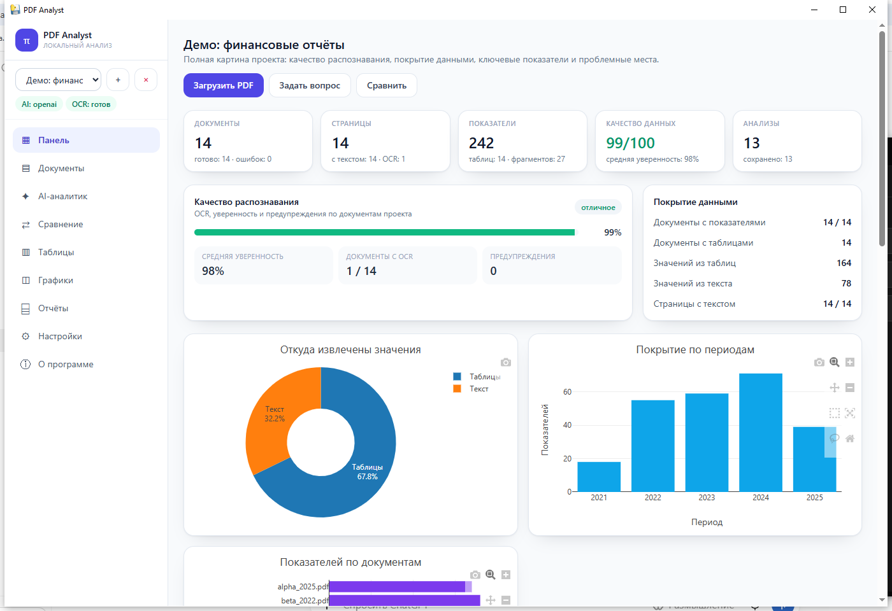

# PDF Analyst — локальный анализ и сравнение PDF-документов

[](https://github.com/VadimKa456/PDF-Analyst/actions/workflows/ci.yml)
[](https://github.com/VadimKa456/PDF-Analyst/releases/latest)
[](LICENSE)
[](https://www.python.org/)
[](CONTRIBUTING.md)

Полностью локальное приложение для загрузки, извлечения, анализа, сравнения и экспорта данных из PDF-документов на русском и английском языках, включая сканы (OCR). Работает как веб-приложение (FastAPI + SPA) и как отдельное desktop-приложение Windows.



[English documentation](README_EN.md) · [Готовые тексты объявления](ANNOUNCEMENT.md) · [Скачать установщик](https://github.com/VadimKa456/PDF-Analyst/releases/latest)

Ключевой принцип: **каждое число и каждый вывод имеют ссылку на документ, страницу и фрагмент-источник**. Все расчёты выполняются на Python; LLM (если подключена) используется только для формулировок и не может добавлять числа, которых нет в проверенных данных.

---

## Возможности

### Документы
- Множественная загрузка PDF (drag & drop, выбор файлов).
- Извлечение текста, структуры, таблиц, чисел, дат, единиц измерения и периодов.
- OCR сканированных страниц: Tesseract + OpenCV-препроцессинг, русский и английский языки.
- Автоматическое определение необходимости OCR (мало текста на странице).
- Восстановление таблиц из OCR по координатам слов; отрицательные суммы в скобках,
  коды строк и группа колонок «Вид | Период | Сумма» распознаются корректно.
- Валюта и масштаб (`тыс. руб.`) подхватываются из шапки и подписей страницы.
- Покрытие чисел: для каждого документа видно, сколько значимых чисел найдено,
  сколько привязано к показателям, а сколько относится к кодам, реквизитам, датам и годам.
- Дашборд проекта: качество распознавания, покрытие данными, динамика по периодам,
  ключевые показатели и документы, требующие внимания.
- Превью страниц, просмотр исходного PDF, полнотекстовый поиск (SQLite FTS5).
- Асинхронная обработка с прогрессом, повторная обработка, удаление документов.
- Проекты: отдельные наборы документов, истории анализов и настройки; создание и удаление проекта с полной каскадной очисткой данных.
- Раздел «О программе»: логотип VADIJI, версия, автор VADIJI | AI Creative Studio и e-mail vadiji.ai@gmail.com.

### AI-аналитик
- Вопросы на естественном языке к загруженным документам.
- RAG: поиск релевантных фрагментов (FTS5; опционально эмбеддинги OpenAI/Ollama).
- Ответы с таблицами, выводами, предупреждениями и кликабельными источниками.
- Работа **без внешнего AI** — встроенный детерминированный аналитический движок.
- Подключение OpenAI-совместимых API и Ollama.
- Защита от галлюцинаций: LLM получает только структурированные факты, а её ответ проверяется на наличие чисел, которых нет в данных.
- Приватность: полные PDF и полный текст документов в облако не отправляются.

### Сравнение
- Нечёткое и межъязыковое сопоставление показателей с разными названиями
  (например, «Выручка» и «Revenue», «Чистая прибыль» и «Net profit»).
- Сравнение по документам и периодам (годы, кварталы, даты).
- Абсолютные и процентные изменения, тренды, база сравнения.
- Пропуски отличаются от нулевых значений.
- Противоречия между документами одной организации.
- Учёт единиц и валют: несовместимые единицы не сравниваются без конвертации.
- Сравнение текстовых фрагментов.
- Прозрачные формулы расчётов.

### Таблицы и графики
- 7 типов интерактивных таблиц: сравнение, динамика, сводная, пропуски,
  противоречия, экстремумы, средние значения.
- Сортировка, фильтры, выбор столбцов, группировка, фильтр по периоду.
- Plotly-графики: line, bar, histogram, pie, stacked bar, scatter, heatmap.
- Несколько графиков на один запрос, только реальные данные.
- Экспорт графиков в PNG.

### Экспорт
- Excel (`.xlsx`): отчёт, таблицы, источники, данные графиков.
- CSV (UTF-8 BOM, разделитель `;`).
- PDF-отчёт: титул, дата, список документов, параметры запроса, таблицы,
  графики, выводы, предупреждения, источники.
- PNG графиков.

### Интерфейс
Разделы: **Dashboard**, **Documents**, **AI Analyst**, **Compare**, **Tables**,
**Charts**, **Reports**, **Settings**, **О программе**.

### Desktop-приложение (Windows 10/11)
Готовый установщик **скачивается из [GitHub Releases](https://github.com/VadimKa456/PDF-Analyst/releases/latest)**:
[`PDF-Analyst-Setup.exe`](https://github.com/VadimKa456/PDF-Analyst/releases/download/v1.1.0/PDF-Analyst-Setup.exe) (один `.exe`, ~172 МБ).

> Каталоги `dist/` и `build/` намеренно **не хранятся в Git** (это артефакты сборки).
> Исходники собираются локально командой `build_desktop.bat`; готовый бинарник
> публикуется в разделе **Releases**, а не в репозитории.

Приложение запускается в **собственном окне** (без браузера), данные хранятся в
`%LOCALAPPDATA%\PDF Analyst\data`. Установщик проверяет и предлагает доустановить
Edge WebView2 Runtime и Visual C++ Redistributable; для Tesseract OCR открывает
страницу загрузки. Подробности — в `DESKTOP_BUILD.md`.

---

## Стек

| Слой | Технологии |
|------|------------|
| Backend | Python 3.12, FastAPI, Pydantic, SQLAlchemy, SQLite (+ FTS5) |
| PDF / OCR | PyMuPDF, pdfplumber, Tesseract, pytesseract, OpenCV, Pillow |
| Аналитика | Pandas, NumPy, rapidfuzz |
| AI | OpenAI-совместимый API, Ollama, локальный детерминированный движок |
| Frontend | React 18, TypeScript, Vite, Tailwind CSS |
| Графики | Plotly (`plotly.js-dist-min`) |
| Экспорт | OpenPyXL, ReportLab, matplotlib |
| Тесты | pytest (132 теста), сквозной HTTP E2E-тест |

---

## Требования

- **Windows 10/11** (приложение также работает на Linux/macOS, но скрипты запуска — для Windows).
- **Python 3.11+** (проверено на 3.12).
- **Node.js 18+** — только для сборки frontend из исходников (`npm install && npm run build`). Каталог `frontend/dist` не хранится в Git: при клонировании его нет, сборка создаётся локально (или используется готовый desktop-установщик из Releases).
- **Tesseract OCR** — только для сканированных PDF.
  - Windows: установите [Tesseract для Windows](https://github.com/UB-Mannheim/tesseract/wiki).
  - При установке отметьте язык **Russian** (файл `rus.traineddata`).
  - Приложение автоматически ищет `tesseract.exe` в стандартных местах, включая
    `%LOCALAPPDATA%\Programs\Tesseract-OCR\tesseract.exe`.
  - Путь можно задать в разделе **Settings** или в `.env` (`TESSERACT_CMD`).

---

## Быстрый старт (Windows)

1. Установите Python 3.12 и (при необходимости) Tesseract с русским языком.
2. В корне проекта запустите:

```bat
setup.bat
```

Скрипт создаст `.venv`, установит Python-зависимости, при наличии Node.js соберёт frontend и создаст `.env` из `.env.example`.

3. Запустите приложение:

```bat
start.bat
```

4. Откройте **http://127.0.0.1:8000** — браузер откроется автоматически.

Остановить сервер: `Ctrl+C` в окне консоли.

### Ручной запуск

```powershell
# 1. Python-окружение
python -m venv .venv
.\.venv\Scripts\activate
pip install -r requirements.txt

# 2. Frontend (если нужно пересобрать)
cd frontend
npm install
npm run build
cd ..

# 3. Сервер
cd backend
python -m uvicorn app.main:app --host 127.0.0.1 --port 8000
```

Приложение: http://127.0.0.1:8000  
API-документация: http://127.0.0.1:8000/api/docs

### Режим разработки frontend

```powershell
# терминал 1 — backend
cd backend
python -m uvicorn app.main:app --reload --port 8000

# терминал 2 — frontend с hot reload
cd frontend
npm run dev
```

Vite проксирует `/api` на `http://127.0.0.1:8000`.

---

## Настройка AI

Все настройки доступны в разделе **Settings** и сохраняются в SQLite. Значения из интерфейса имеют приоритет над `.env`.

### Локальный режим (по умолчанию)

```env
AI_PROVIDER=none
```

Внешняя модель не используется. Вопросы обрабатываются встроенным аналитическим движком: поиск показателей, расчёты, сравнение, таблицы, графики и выводы формируются детерминированно. Это полностью локальный режим.

### Ollama

```env
AI_PROVIDER=ollama
OLLAMA_BASE_URL=http://localhost:11434
OLLAMA_MODEL=llama3.1
OLLAMA_EMBEDDING_MODEL=nomic-embed-text
```

Убедитесь, что Ollama запущена и модель загружена:

```bash
ollama pull llama3.1
ollama serve
```

### OpenAI / совместимый API

```env
AI_PROVIDER=openai
OPENAI_BASE_URL=https://api.openai.com/v1
OPENAI_API_KEY=sk-...
OPENAI_MODEL=gpt-4o-mini
OPENAI_EMBEDDING_MODEL=text-embedding-3-small
```

Можно указать любой OpenAI-совместимый endpoint (LM Studio, vLLM, OpenRouter и т. п.).

**Важно:** имя модели должно совпадать с тем, что поддерживает провайдер. У
агрегаторов (OpenRouter, anymodel и др.) используются префиксы, например
`glm/glm-4.7`, `am/free`, поэтому стандартное `gpt-4o-mini` может быть недоступно.
В разделе **Settings → AI-провайдер** нажмите «Список моделей»: приложение
загрузит доступные модели, покажет их с фильтром и подставит выбранную. Кнопка
«Проверить соединение» выводит точную ошибку, а при ответе `model_not_found`
предлагает доступные модели и время отклика. Модель эмбеддингов проверяется
отдельной кнопкой «Проверить эмбеддинги»; если провайдер её не поддерживает,
семантический поиск автоматически откатывается к лексическому (FTS5) с
предупреждением, а анализ продолжает работать.

**Безопасность ключей:** ключ хранится в локальной SQLite, никогда не логируется
и не возвращается в открытом виде через API — только маска вида `sk-1…cdef`.

**Что уходит в облако:** только структурированные факты (таблицы, показатели,
источники, предупреждения) и фрагменты, необходимые для ответа. Полные PDF и
полный текст документов не передаются. Ответ модели проверяется: если в нём есть
число, которого нет в проверенных данных, ответ отклоняется и используется
детерминированный вариант.

---

## OCR

```env
OCR_ENABLED=true
OCR_LANGUAGES=rus+eng
OCR_DPI=300
OCR_MIN_CONFIDENCE=65
OCR_AUTO=true
```

- `OCR_AUTO=true` — OCR запускается автоматически, если на странице мало извлекаемого текста.
- Для плохих сканов увеличьте `OCR_DPI` до 400–600.
- Проверка Tesseract доступна в **Settings → OCR → Проверить**.
- Языки должны быть установлены в Tesseract (`rus.traineddata`, `eng.traineddata`).

Пайплайн распознавания:

1. Страница рендерится при `OCR_DPI` (по умолчанию 300; диапазон 150–600);
   при необходимости ширина увеличивается до ~2000 px.
2. OpenCV: перевод в оттенки серого, выравнивание наклона (deskew),
   `fastNlMeansDenoising`. Готовятся три варианта изображения: адаптивная
   бинаризация (порог 31/15), Otsu и «светлый» вариант без бинаризации — он
   сохраняет мелкие цифры в узких колонках таблиц.
3. Tesseract (`--oem 3`, `psm 3` и `psm 6`) запускается по несколько проходов
   для разных вариантов изображения; слова берутся из `image_to_data` с
   уверенностью и координатами, строки собираются по `block_num/par_num/line_num`.
4. Выбирается лучший проход: учитываются уверенность, качество (отсутствие
   аномалий) и количество найденных чисел. Дополнительный проход побеждает
   только если нашёл существенно больше чисел (например, `1`/`0` в колонках
   бланка оценки) или заметно лучше по качеству — так не ломаются обычные
   финансовые таблицы.
5. Числа нормализуются: исправляются OCR-подмены (`О`→`0`, `З`→`3`),
   восстанавливаются потерянные разряды (`4061 444 118` → `4 061 444 118`),
   `6/` в конце числа трактуется как `7`, восстанавливается висячая десятичная
   запятая (`1153233 ,` → `11 532,33`).
6. Таблицы восстанавливаются по координатам слов: строки — по вертикали,
   колонки — по кластерам числовых слов и зазорам между словами; шапка
   определяется эвристикой (год в шапке не обязателен), многострочные подписи
   и criteria-строки без чисел включаются в таблицу.

При уверенности ниже `OCR_MIN_CONFIDENCE` документ получает предупреждение;
на дашборде такие документы попадают в блок «Требуют внимания».

---

## Как это работает

### 1. Обработка PDF

1. PyMuPDF извлекает текст, блоки, таблицы и координаты слов.
2. Если текста мало — страница рендерится в изображение и распознаётся Tesseract.
3. OpenCV выполняет препроцессинг (масштаб, бинаризация, удаление шума).
4. Таблицы:
   - PyMuPDF `find_tables()` + пересборка ячеек по словам;
   - для OCR — кластеризация слов по строкам и числовым колонкам.
5. Из текста и таблиц извлекаются показатели: название, значение, единица,
   валюта, период, страница, фрагмент, уверенность.
6. Нормализация: приведение чисел к единому масштабу, определение валюты,
   очистка названий от единиц и годов.
7. Данные сохраняются в SQLite; текст индексируется в FTS5.

### 2. Аналитика

- Показатели кластеризуются по смыслу (рус/англ синонимы + нечёткое сравнение).
- Сравнение учитывает единицы, валюты, периоды, пропуски и противоречия.
- Проценты и абсолютные изменения считаются на Python по прозрачным формулам:
  - `Δ = новое − базовое`
  - `Δ% = (новое − базовое) / |базовое| × 100`
  - при базе `0` процент не рассчитывается (отображается «—»).
- Несовместимые единицы/валюты не сравниваются; выводится предупреждение.

### 3. AI / RAG

1. Запрос определяет интент: вопрос, сравнение, таблица, график, пропуски, противоречия и т. д.
2. Лексический поиск FTS5 (опционально — семантические эмбеддинги) находит фрагменты.
3. Аналитический движок строит таблицы, расчёты и графики.
4. LLM (если включена) формулирует ответ на основе фактов.
5. Ответ валидируется; источники прикрепляются к каждому значению.

---

## Структура проекта

```
PDF-Analyst/
├── backend/
│   ├── app/
│   │   ├── api/                 # REST-роутеры: projects, documents, analysis,
│   │   │                        # compare, tables_charts, dashboard, search,
│   │   │                        # options, settings, exports
│   │   ├── services/            # pdf_processor, analytics, retrieval,
│   │   │                        # query_engine, builders, exports, ai_client,
│   │   │                        # jobs, runtime_settings
│   │   └── config.py, database.py, models.py, schemas.py, utils.py, main.py
│   ├── tests/                   # 132 pytest-теста
│   ├── _final_e2e.py            # сквозной HTTP-тест (78 проверок)
│   └── pytest.ini
├── frontend/
│   ├── public/                  # vadiji-logo.jpg, LICENSE.txt
│   ├── src/
│   │   ├── pages/               # Dashboard, Documents, Analyst, Compare,
│   │   │                        # Tables, Charts, Reports, Settings, About
│   │   ├── components/ui.tsx    # DataTable, ChartView, AnswerCard и др.
│   │   └── api.ts, state.tsx, types.ts, main.tsx, index.css
│   ├── package.json, package-lock.json, vite.config.ts, tailwind.config.js
│   └── dist/                    # генерируется npm run build (НЕ в Git)
├── samples/
│   ├── generate_samples.py      # генератор тестовых PDF
│   └── pdfs/                    # создаётся скриптом (НЕ в Git)
├── screenshots/
│   └── desktop-dashboard.png    # скриншот приложения для README
├── data/                        # БД, загрузки, экспорты (НЕ в Git, есть .gitkeep)
├── .github/workflows/ci.yml     # CI: pytest + сборка frontend
├── .env.example, .gitignore, .gitattributes
├── LICENSE, README.md, README_EN.md, ANNOUNCEMENT.md
├── FINAL_REPORT.md, DESKTOP_BUILD.md, CONTRIBUTING.md, SECURITY.md, ACCESSIBILITY.md
├── desktop_app.py               # desktop-лаунчер (pywebview + FastAPI)
├── pdf_analyst.spec, installer.iss, build_desktop.bat
├── requirements.txt, requirements-desktop.txt
└── setup.bat, start.bat, run_tests.bat
```

### Состав репозитория

Ветка `main` содержит **97 файлов**:

| Каталог | Файлов | Содержимое |
|---------|--------|------------|
| `backend/` | 40 | приложение FastAPI, 9 файлов тестов (`conftest.py` + 8 `test_*.py`), `_final_e2e.py`, `pytest.ini` |
| `frontend/` | 27 | исходники React/TS, `public/`, конфиги сборки (без `dist/`) |
| `.github/` | 6 | `workflows/ci.yml`, CODE_OF_CONDUCT, PR-шаблон, 3 issue-шаблона |
| `data/` | 1 | только `.gitkeep` (БД и загрузки не хранятся) |
| `samples/` | 1 | `generate_samples.py` (PDF генерируются локально) |
| `screenshots/` | 1 | скриншот desktop-приложения для README |
| корень | 21 | `README.md`, `README_EN.md`, `ANNOUNCEMENT.md`, `FINAL_REPORT.md`, `DESKTOP_BUILD.md`, `CONTRIBUTING.md`, `SECURITY.md`, `ACCESSIBILITY.md`, `LICENSE`, `.env.example`, `.gitignore`, `.gitattributes`, `desktop_app.py`, `pdf_analyst.spec`, `installer.iss`, `build_desktop.bat`, `requirements*.txt`, `setup.bat`, `start.bat`, `run_tests.bat` |

Всего: 41 Python-файл, 17 TypeScript/TSX, 10 Markdown. Готовый установщик — в
[GitHub Releases](https://github.com/VadimKa456/PDF-Analyst/releases/latest), а не в репозитории.

### Модель данных

- `Project` — проект.
- `Document` — PDF: статус, страницы, OCR, уверенность, путь к файлу.
- `Page` — текст страницы, метод извлечения, уверенность.
- `Table` — таблица: заголовки, строки, метод, подпись.
- `Metric` — показатель: значение, единица, валюта, период, страница,
  фрагмент, уверенность, источник.
- `Chunk` — фрагмент текста для RAG.
- `Analysis` — сохранённый запрос, ответ, таблицы, графики, источники.
- `Setting` — настройки AI/OCR/экспорта.

---

## API

Полная интерактивная документация: **`/api/docs`** (Swagger UI).

Основные endpoints:

| Метод | Путь | Назначение |
|-------|------|------------|
| GET | `/api/health` | Статус, документы, Tesseract, AI |
| GET/POST | `/api/projects` | Список / создание проектов |
| GET/PUT/DELETE | `/api/projects/{id}` | Проект |
| POST | `/api/projects/{id}/open` | Отметить открытие |
| GET/POST | `/api/projects/{id}/documents` | Список / загрузка PDF |
| GET/DELETE | `/api/documents/{id}` | Документ |
| GET | `/api/documents/{id}/file` | Исходный PDF |
| GET | `/api/documents/{id}/pages` | Страницы |
| GET | `/api/documents/{id}/pages/{n}` | Текст страницы |
| GET | `/api/documents/{id}/pages/{n}/image` | Превью PNG |
| GET | `/api/documents/{id}/tables` | Таблицы |
| GET | `/api/documents/{id}/metrics` | Показатели |
| GET | `/api/documents/{id}/coverage` | Покрытие чисел страницы |
| POST | `/api/documents/{id}/reprocess` | Повторная обработка |
| POST | `/api/analyses` | Новый анализ / вопрос |
| GET | `/api/analyses` | История анализов |
| GET/DELETE | `/api/analyses/{id}` | Анализ |
| POST | `/api/analyses/{id}/rerun` | Повторить |
| PUT | `/api/analyses/{id}/saved` | Закрепить/открепить |
| POST | `/api/compare` | Сравнение |
| POST | `/api/tables/build` | Построение таблицы |
| POST | `/api/charts/build` | Построение графиков |
| GET | `/api/dashboard` | Сводка проекта |
| POST | `/api/search` | Полнотекстовый поиск |
| GET | `/api/options` | Показатели, периоды, документы |
| GET/PUT | `/api/settings` | Настройки |
| GET | `/api/settings/ai/models` | Модели AI |
| POST | `/api/settings/ai/models` | Модели AI с учётом несохранённых полей формы |
| POST | `/api/settings/ai/test` | Проверка AI (ошибка, подсказка по моделям, задержка) |
| POST | `/api/settings/ai/embedding/test` | Проверка модели эмбеддингов |
| POST | `/api/settings/ocr/check` | Проверка Tesseract |
| POST | `/api/export/{fmt}` | Excel / CSV / PDF |
| POST | `/api/export/chart-png` | PNG графика |

---

## Тесты

### Тестовые данные

Каталог `samples/pdfs/` не хранится в Git. После клонирования репозитория
сгенерируйте 14 синтетических PDF:

```powershell
python samples/generate_samples.py
```

### Модульные и интеграционные тесты

```powershell
cd backend
python -m pytest -q
```

Покрывают:

- разбор чисел, единиц, валют, периодов, форматирование;
- восстановление OCR-чисел (потерянные разряды, подмены символов, отрицательные суммы);
- разбор таблиц: код строки vs значение, повторяющиеся группы колонок, единицы страницы,
  подпункты разделов («Себестоимость продаж, в т.ч. продажа газа»);
- покрытие чисел: служебные коды, реквизиты, даты и годы не искажают покрытие;
- межъязыковое и нечёткое сопоставление показателей;
- расчёты: абсолютные/процентные изменения, нулевая база,
  несовместимые единицы, пропуски vs ноль, противоречия, динамика, экстремумы;
- точность извлечения из `alpha_2024.pdf` и `beta_2025_english.pdf`;
- OCR скана и восстановление таблиц;
- целостность экспорта XLSX/CSV/PDF, наличие источников;
- маскирование API-ключей, доступность AI, отсутствие утечки полного текста,
  отклонение выдуманных чисел.

Ожидаемый результат: **132 passed**.

### Сквозной E2E-тест

Сервер должен быть запущен на `http://127.0.0.1:8000`.

```powershell
cd backend
$env:PYTHONIOENCODING="utf-8"
python _final_e2e.py
```

Проверяет полный путь UI → API → обработка → БД → ответ: загрузку 14 PDF,
прогресс, OCR, страницы, таблицы, показатели, источники, вопросы,
сравнение, таблицы, графики, экспорт, настройки и поиск.
Создаёт временный проект и удаляет его в конце.

Ожидаемый результат: **78 проверок, 0 ошибок** (включая лицензию MIT, удаление проекта и каскадную очистку БД/FTS).

---

## Хранение данных и приватность

- По умолчанию всё работает локально: SQLite, файлы PDF и экспорты — в `data/`.
- Внешний AI отключён (`AI_PROVIDER=none`).
- При включении OpenAI/облака передаются только структурированные факты и
  найденные фрагменты, а не PDF целиком.
- API-ключи маскируются при выдаче через API и не попадают в логи.
- Приложение не имеет встроенной аутентификации и рассчитано на локальный
  однопользовательский запуск. Не открывайте порт `8000` в интернет без
  дополнительной защиты (reverse proxy, авторизация, TLS).

### Сброс данных

Остановите сервер и удалите каталог `data/` (или только `data/app.db`).
При следующем запуске база будет создана заново.

---

## Ограничения

- **Проверка UI** выполнена для ключевых экранов (About, Reports, экспорт) через
  встроенный браузер, а также полным API E2E. Остальные разделы проверены
  TypeScript-сборкой, Vite-сборкой и HTTP-раздачей SPA.
- **Облачный AI** проверен на реальном OpenAI-совместимом провайдере
  (`https://anymodel.org/v1`): список моделей, чат, JSON-режим, повтор временных
  `503` и полный цикл AI-аналитика. У этого провайдера нет модели
  `gpt-4o-mini` — используется `glm/glm-4.7`; модель эмбеддингов недоступна,
  поэтому семантический поиск выключен (FTS5). Ollama не запускалась в этом
  окружении.
- **OCR и таблицы** — эвристические: качество зависит от скана, шрифта, языка
  и разрешения. Сложные многоуровневые таблицы могут требовать ручной проверки.
- **PDF с паролем** не поддерживаются.
- **Конвертация валют** не выполняется: разные валюты не сравниваются без
  явного курса (выводится предупреждение).
- **Семантический поиск** через эмбеддинги опционален и требует внешней модели;
  по умолчанию используется FTS5.
- Приложение не заменяет аудиторскую проверку: результаты и источники следует
  сверять с оригиналами документов.

---

## Устранение неполадок

| Проблема | Решение |
|----------|---------|
| `Port 8000 is already in use` | Остановите другой процесс или задайте `PORT=8001` в `.env` |
| `Tesseract not found` | Установите Tesseract с русским языком; укажите путь в Settings или `TESSERACT_CMD` |
| `Frontend ещё не собран` | После клонирования выполняется `cd frontend && npm install && npm run build` (каталог `dist` не хранится в Git) |
| `node`/`npm` не найдены | Установите Node.js 18+ или скачайте готовый desktop-установщик из [Releases](https://github.com/VadimKa456/PDF-Analyst/releases/latest) |
| Русский текст в OCR не распознаётся | Проверьте `rus.traineddata` и языки в Settings (`rus+eng`) |
| Медленная обработка сканов | Уменьшите `OCR_DPI` (например, 200) или отключите OCR для текстовых PDF |
| Пустые таблицы | PDF может не содержать таблиц как структуры; проверьте текст страницы и OCR |
| Ошибка AI | Проверьте base URL, ключ, модель и доступность сети; при ошибке приложение вернётся к локальному движку |
| Нужно начать с чистого листа | Остановите сервер и удалите `data/app.db` (и при необходимости `data/uploads`) |

---

## Участие в разработке

- [CONTRIBUTING.md](CONTRIBUTING.md) — как подготовить окружение, запустить тесты и отправить PR.
- [.github/CODE_OF_CONDUCT.md](.github/CODE_OF_CONDUCT.md) — кодекс поведения участников.
- [.github/ISSUE_TEMPLATE](.github/ISSUE_TEMPLATE) — шаблоны для сообщений об ошибках и предложений.
- [.github/PULL_REQUEST_TEMPLATE.md](.github/PULL_REQUEST_TEMPLATE.md) — чек-лист pull request.
- [SECURITY.md](SECURITY.md) — как приватно сообщить об уязвимости.
- [ACCESSIBILITY.md](ACCESSIBILITY.md) — доступность и известные ограничения.
- [ANNOUNCEMENT.md](ANNOUNCEMENT.md) — готовые тексты для объявления проекта.
- [GitHub Community](https://github.com/VadimKa456/PDF-Analyst/community) — стандарты сообщества проекта.

---

## Лицензия и назначение

**PDF Analyst распространяется по лицензии MIT.** Полный текст — в файле
[`LICENSE`](LICENSE) в корне проекта (также доступен в разделе «О программе» и
входит в состав desktop-установщика).

```
MIT License
Copyright (c) 2026 VADIJI | AI Creative Studio
```

Проект создан как локальный инструмент анализа PDF. Сторонние библиотеки
(PyMuPDF, OpenCV, FastAPI, Plotly и др.) распространяются по своим лицензиям.
Перед промышленным использованием проверьте требования к защите персональных
и коммерческих данных.
