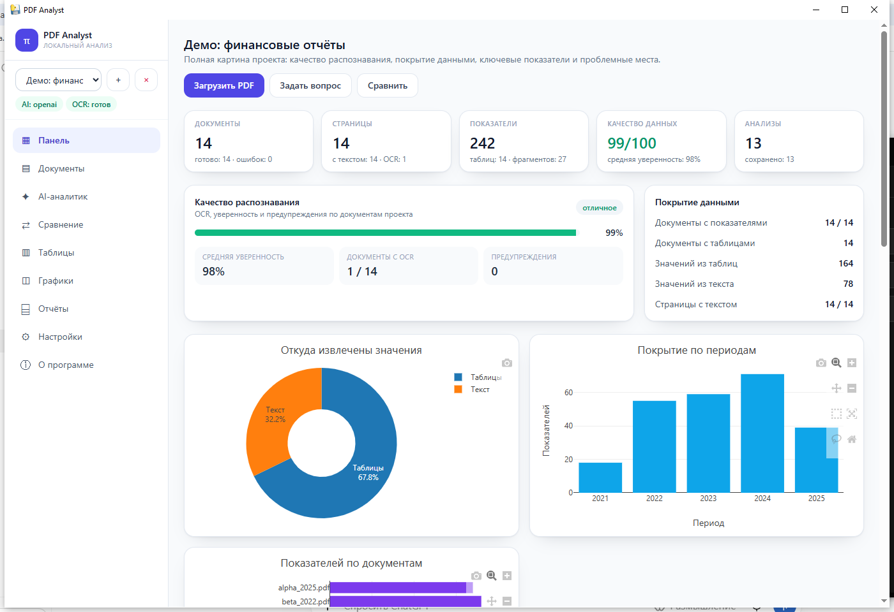

# PDF Analyst — local PDF analysis and comparison

[](https://github.com/VadimKa456/PDF-Analyst/actions/workflows/ci.yml)
[](https://github.com/VadimKa456/PDF-Analyst/releases/latest)
[](LICENSE)
[](https://www.python.org/)
[](CONTRIBUTING.md)



A fully local application for extracting, analysing, comparing and exporting data from PDF documents in Russian and English, including scanned PDFs via OCR. It runs both as a web app (FastAPI + SPA) and as a **standalone Windows desktop application**.

**Core principle:** every number and every conclusion has a reference to the document, page and source snippet. All calculations are performed locally in Python; an LLM (if enabled) only phrases results and can never add numbers that are not in the verified data.

[Russian documentation](README.md) · [Announcement texts](ANNOUNCEMENT.md) · [Download installer](https://github.com/VadimKa456/PDF-Analyst/releases/latest) · [Community standards](https://github.com/VadimKa456/PDF-Analyst/community)

---

## Features

### Documents
- Multi-file PDF upload (drag & drop).
- Extraction of text, tables, numbers, dates, units and periods.
- OCR of scanned pages: Tesseract + OpenCV preprocessing, `rus` and `eng`.
- Automatic OCR detection when a page has too little text.
- Table reconstruction from word coordinates; negative amounts in parentheses, line codes and repeated column groups.
- Currency and scale detection (`thousand RUB`) from headers and captions.
- Number coverage report: significant numbers vs codes, requisites, dates and years.
- Project dashboard: quality, data coverage, periods, key metrics and documents requiring attention.
- Page previews, original PDF viewer and full-text search (SQLite FTS5).
- Async processing with progress, reprocessing and document deletion.
- Projects: create/delete with full cascade cleanup of DB and FTS index.
- «About» section with version, author (VADIJI | AI Creative Studio) and MIT license.

### AI analyst
- Natural-language questions over your documents.
- RAG: FTS5 retrieval, optionally embeddings from OpenAI-compatible APIs or Ollama.
- Answers with tables, findings, warnings and clickable sources.
- Works **without any external AI** — a built-in deterministic analytics engine.
- Hallucination guard: the LLM receives only structured facts and its answer is validated for invented numbers.
- Privacy: full PDFs and full document text are never sent to the cloud.

### Comparison and analytics
- Fuzzy and cross-language matching (e.g. «Выручка» ↔ «Revenue»).
- Comparison by document and period (years, quarters, dates).
- Absolute/percentage changes, trends, transparent formulas.
- Missing values are distinct from zeros; incompatible units are never compared without conversion.
- Contradictions within the same entity and text fragment comparison.

### Tables, charts and export
- 7 interactive table types: comparison, dynamics, summary, missing, contradictions, extrema, averages.
- Sorting, filters, column selection, grouping and period filtering.
- Plotly charts: line, bar, stacked bar, pie, scatter, histogram, heatmap.
- Export to Excel (`.xlsx`), CSV (UTF-8 BOM, `;`), PDF report and PNG charts.
- In desktop mode, export opens a native **Save As** dialog (WebView2 blob downloads are unreliable).

---

## Install (Windows 10/11 x64)

Download the single installer from [GitHub Releases](https://github.com/VadimKa456/PDF-Analyst/releases/latest) and run `PDF-Analyst-Setup.exe`. The installer checks for and offers to install missing components:

- Microsoft Edge WebView2 Runtime (required for the standalone window),
- Visual C++ Redistributable 2015–2022 x64,
- Tesseract OCR (optional, for scanned PDFs; install with `rus`/`eng`).

The app opens in its own window (not a browser) and stores data in `%LOCALAPPDATA%\PDF Analyst\data`.

### From source

```powershell
python -m venv .venv
.\.venv\Scripts\activate
pip install -r requirements.txt
cd frontend
npm install
npm run build
cd ..\backend
python -m uvicorn app.main:app --host 127.0.0.1 --port 8000
```

Open http://127.0.0.1:8000 (API docs: `/api/docs`). On Windows you can also use `setup.bat` and `start.bat`.

> The repository does not contain `frontend/dist`, `build/`, `data/` contents or generated sample PDFs — they are produced locally (see [CONTRIBUTING.md](CONTRIBUTING.md)).

---

## Tests

```powershell
cd backend
python -m pytest -q          # 132 passed
$env:PYTHONIOENCODING="utf-8"
python _final_e2e.py         # requires a running server; 78 checks, 0 errors
```

Generate sample PDFs if `samples/pdfs/` is empty: `python samples/generate_samples.py`.

---

## Project structure

```
PDF-Analyst/
├── backend/           # FastAPI app, services, tests, E2E test
├── frontend/          # React 18 + TypeScript + Vite sources
├── samples/           # generate_samples.py (PDFs generated locally)
├── screenshots/       # README screenshot
├── desktop_app.py     # pywebview launcher
├── pdf_analyst.spec, installer.iss, build_desktop.bat
├── README.md, README_EN.md, FINAL_REPORT.md, DESKTOP_BUILD.md
├── CONTRIBUTING.md, SECURITY.md, ACCESSIBILITY.md
├── LICENSE (MIT), .env.example, requirements*.txt
└── .github/           # CI, Code of Conduct, issue/PR templates
```

---

## License and credits

**MIT License** — see [LICENSE](LICENSE).

Author: **VADIJI | AI Creative Studio** · vadiji.ai@gmail.com

Third-party libraries (PyMuPDF, OpenCV, FastAPI, Plotly, etc.) are distributed under their own licenses. This tool does not replace professional audit: always verify results against the original documents.
